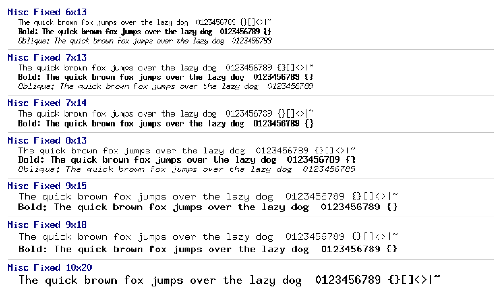
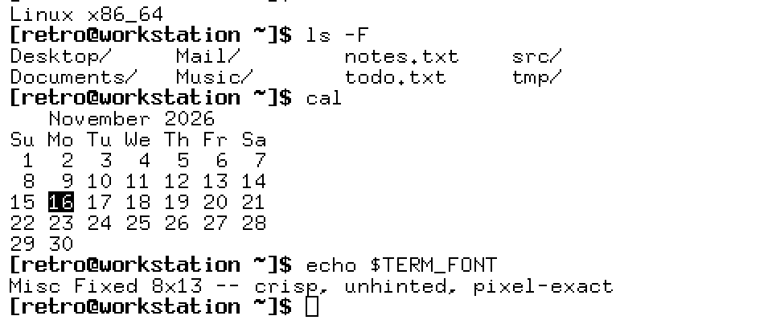

# misc-fixed-ttf

The classic X11 **misc-fixed** bitmap fonts (the ones behind `xterm -fn 8x13`)
as pixel-exact TrueType, for terminals and apps that no longer load bitmap fonts,
such as kitty, foot and anything on Wayland.



<p align="center"></p>
<p align="center"><sub>foot with <code>Misc Fixed 8x13</code>, unhinted, at its native 13 px (shown at 2×)</sub></p>

The glyphs are converted from X.Org's `font-misc-misc` 1.1.3 BDFs with
[Bits'N'Picas](https://github.com/kreativekorp/bitsnpicas) into square-pixel
**outlines**, not embedded bitmaps. At the native pixel size they render
identically to the original bitmaps.

## Families

| Family | Regular | Bold | Oblique |
|---|:-:|:-:|:-:|
| `Misc Fixed 6x13` | ✓ | ✓ | ✓ |
| `Misc Fixed 7x13` | ✓ | ✓ | ✓ |
| `Misc Fixed 7x14` | ✓ | ✓ | |
| **`Misc Fixed 8x13`** | ✓ | ✓ | ✓ |
| `Misc Fixed 9x15` | ✓ | ✓ | |
| `Misc Fixed 9x18` | ✓ | ✓ | |
| `Misc Fixed 10x20` | ✓ | | |

There are no synthesized styles. Each style keeps exactly the upstream glyph
coverage. For example, 8x13 has 3703 / 1141 / 1295 glyphs in Regular / Bold /
Oblique, so Bold and Oblique lack some characters (including some box drawing)
that Regular has. That gap is in the original fonts, not caused by conversion.

## Install

```nix
# flake.nix
inputs.misc-fixed-ttf = {
  url = "github:Gustlik501/misc-fixed-ttf";
  inputs.nixpkgs.follows = "nixpkgs";
};

# then add the overlay (pkgs.misc-fixed-ttf) …
nixpkgs.overlays = [ inputs.misc-fixed-ttf.overlays.default ];

# … and install it. NixOS:
fonts.packages = [ pkgs.misc-fixed-ttf ];
# or Home Manager:
home.packages = [ pkgs.misc-fixed-ttf ];
fonts.fontconfig.enable = true;
```

Without the overlay, use `inputs.misc-fixed-ttf.packages.x86_64-linux.default`.
Or try it with `nix build github:Gustlik501/misc-fixed-ttf`.

## Getting crisp pixels

Use the font at its **native pixel height** (13 px for 8x13) or an integer
multiple of it.

- **foot:** `font=Misc Fixed 8x13:pixelsize=13`
- **kitty:** at 96 DPI, 9.75 pt is exactly 13 px:

  ```conf
  font_family Misc Fixed 8x13
  font_size   9.75
  ```

  If it still looks soft, try `text_composition_strategy legacy`.

FreeType's autohinter can nudge isolated accent pixels even at native size. For
exact bitmap fidelity, turn hinting off for these families in fontconfig:

```xml
<match target="font">
  <test name="family" compare="contains"><string>Misc Fixed</string></test>
  <edit name="hinting" mode="assign"><bool>false</bool></edit>
  <edit name="antialias" mode="assign"><bool>false</bool></edit>
</match>
```

The package installs fonts only, with no fontconfig rules or other global
rendering changes.

## What gets installed

- `share/fonts/truetype/MiscFixed-<cell>-<style>.ttf` (16 files)
- `share/doc/misc-fixed-ttf/COPYING` (upstream notice)

<details>
<summary><b>Verification</b></summary>

Build-time checks assert that every BDF codepoint survives, advances are
uniform, and outline tables, family names and style flags are correct. Metadata
normalization also sets `post.isFixedPitch`, which the converter leaves unset,
and stable timestamps.

`fc-scan` reports the 16 expected family/style pairs with spacing = 100 (mono).
Rendered with ImageMagick at 13 px with hinting off, all three 8x13 styles show
**zero differing pixels** against the original PCFs. The samples cover ASCII,
Latin-1, Latin Extended and box drawing, limited to each BDF's coverage.

To repeat the rendering comparison:

```sh
nix build --impure --expr '(import (builtins.getFlake (toString ./.)).inputs.nixpkgs { system = "x86_64-linux"; }).xorg.fontmiscmisc' --out-link result-pcf
nix develop --command python verify.py
```

</details>

## License

The fonts are **public domain**. Upstream's notice reads: *"Public domain font.
Share and enjoy."* The source tarball is pinned by SHA-256 in `package.nix`.

---

Part of a small retro-desktop set for Hyprland:
[hypr-wmdeco](https://github.com/Gustlik501/hypr-wmdeco) ·
[irixium-gtk-theme](https://github.com/Gustlik501/irixium-gtk-theme) ·
[chicago95-cursors](https://github.com/Gustlik501/chicago95-cursors) ·
**misc-fixed-ttf** ·
[nextlike-icons](https://github.com/Gustlik501/nextlike-icons)
